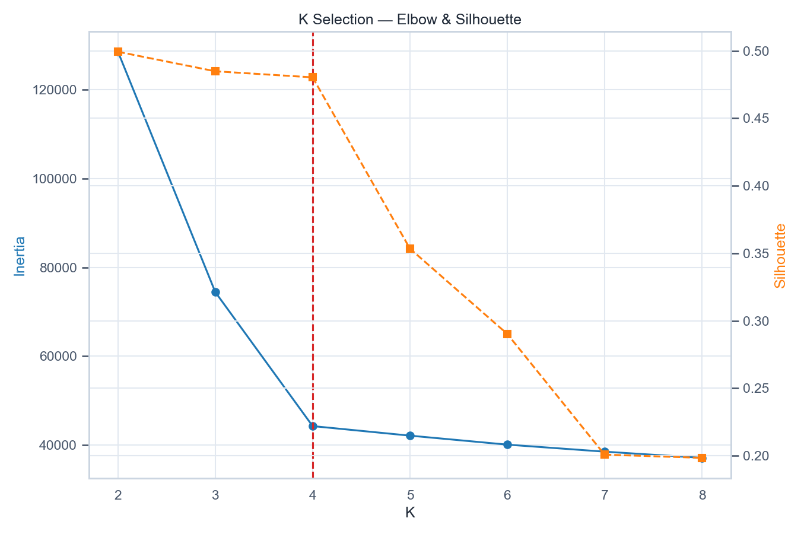
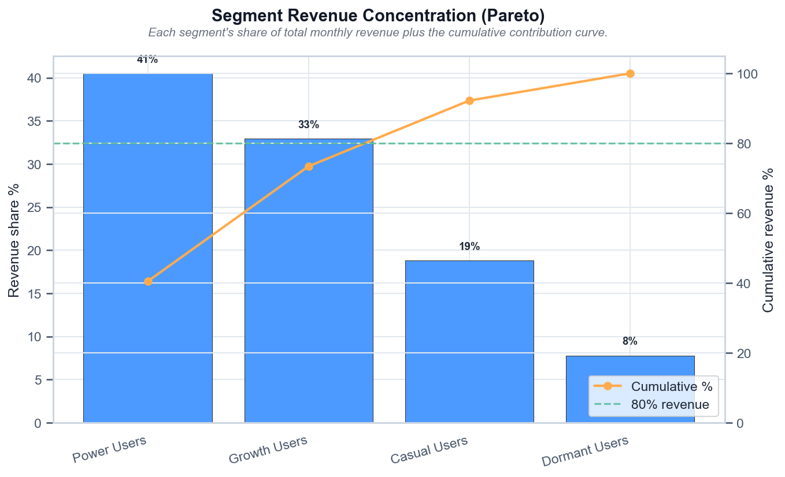
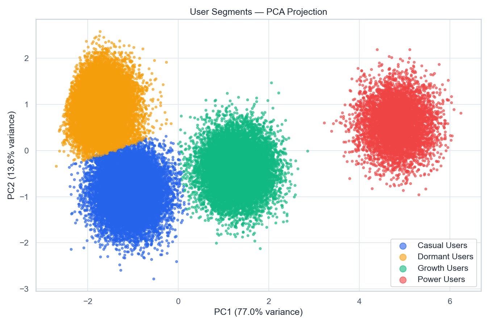
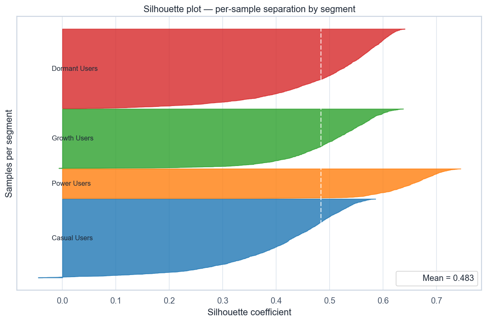

# Volta — User Segmentation

[](https://github.com/NikitaBoyarkin/case-segmentation/actions/workflows/ci.yml)

[](LICENSE)

KMeans with data-driven K=4: Power 12% drive 41% of revenue, 68% drive 92%. Cross-segment migration is worth up to +€310K/yr.

## Navigation

- 📖 [Full case study on the portfolio site](https://nikitaboyarkin.github.io/en/projects/volta/segmentation/)
- 🏦 [Parent project: volta-banking](https://github.com/NikitaBoyarkin/volta-banking)
- 🧪 Related cases: [rfm](https://github.com/NikitaBoyarkin/case-rfm) · [spend](https://github.com/NikitaBoyarkin/case-spend)

**On this page:** [Key results](#key-results) · [Situation](#situation) · [Task](#task) · [Actions](#actions) · [Result](#result) · [Recommendations](#recommendations) · [Charts](#charts) · [Dataset](#dataset) · [Quick start](#quick-start)

## Key results

- K=4 chosen from data (elbow + silhouette)
- 12% of users → 41% of revenue; 68% → 92%
- Cross-segment migration: up to +€310K/yr

## Situation

The effect held — the remaining question was who these users are and how to monetize them.

## Task

With the effect confirmed, my job was to establish who these users actually are and which of their traits open a monetization path.

## Actions

- StandardScaler + KMeans, K from data (marginal-gain elbow, silhouette validation).
- PCA projection of segments and K-selection curves (inertia + silhouette), computed in code rather than shipped as a picture.
- Lorenz concentration and cross-segment migration scenarios.

## Result

- **K=4**: Power 12% / Growth 24% / Casual 32% / Dormant 32% (sizes derived from data).
- **Power** drive **41%** of revenue on 12% of users; **68%** → **92%**.
- Dormant (32%) still drives **7.8%** — win-back has potential.
- Migration scenarios: **+€26K/mo (€310K/yr)**.

## Recommendations

- Defend Power, upgrade Growth/Casual, win back Dormant.
- Build strategy on probabilities, not hard labels (boundaries are soft).
- Validate the strategy with the 4 recommended A/B tests.

## Charts





> # Segment Revenue Concentration (Pareto)
>
> 
>
> *Доля каждого сегмента в месячной выручке и кумулятивная кривая вклада.*
>
> ## Выводы
>
> - Сегмент «Power Users» даёт 41% выручки, занимая 12% пользователей.
> - 68% пользователей приносят ≥80% выручки (порог достигается на «Casual Users»).
> - Выручка сильно сконцентрирована: защищать Power Users и апгрейдить Growth/Casual.
> - Dormant-сегмент всё ещё приносит 8% — у win-back кампаний есть измеримый потенциал.
>
> ---
> <sub>Источник: `scripts/volta_segmentation.py` · данные: `data/segment_profiles.csv`</sub>





## Dataset

The dataset is fully synthetic, generated by seeded, reproducible script(s) (`scripts/generate_segmentation_data.py`). No real customer data is used. Running `make data` regenerates the CSV(s) in `data/` with the same random seed, so every number below is reproducible.

## Quick start

```bash
uv sync --all-groups
make data
make run
```

## Project structure

```text
case-segmentation/
├── README.md
├── LICENSE
├── .gitignore
├── .python-version
├── pyproject.toml
├── Makefile
├── .github/workflows/ci.yml
├── scripts/
│   ├── generate_segmentation_data.py
│   └── volta_segmentation.py
├── utils/
│   ├── __init__.py
│   ├── common.py
│   └── viz_helpers.py
├── data/
│   └── volta_users_features.csv
│   └── segment_profiles.csv
├── outputs/
│   ├── segmentation_k_selection.png
│   ├── segmentation_pareto.png
│   ├── segmentation_pca_scatter.png
│   ├── segmentation_silhouette.png
└── tests/
    └── test_segmentation.py
```

## Stack

- Python
- pandas / NumPy
- SciPy / Statsmodels
- scikit-learn
- Matplotlib / Seaborn
- uv + ruff

## Links

- [Full case study on the portfolio site](https://nikitaboyarkin.github.io/en/projects/volta/segmentation/)
- [Parent project — volta-banking](https://github.com/NikitaBoyarkin/volta-banking)
